  

  
  

## 👨‍💻 About Me

  

- 📱 I am a Flutter developer with 2+ years of experience building production cross-platform mobile applications across iOS and Android.
- ⚡ I specialize in real-time communication (WebRTC, SIP, WebSocket), clean architecture (MVVM, Clean Architecture, Provider), and offline-first design.
- 🚀 I have a strong track record of owning the full development lifecycle from architecture to Play Store and App Store release.
- 🤖 Alongside mobile development, I build multi-profile browser automation scripts in Python and Selenium to streamline workflows.
- 🌌 I'm also deeply interested in AR technology, having previously developed an AR Treasure Hunt application.

## 🚀 Recent Experience & Projects

- 💼 **Flutter Developer:** Owning the complete development lifecycle for applications and migrating legacy codebases to MVVM architecture with Provider to improve testability.
- ⚙️ **Automation Engineer:** Built browser automation tooling in Python and Selenium that replaced approximately 20 hours of manual work per month.
- 📞 **VoIP Calling App:** Developed a cross-platform VoIP application delivering low-latency voice calls using SIP and WebRTC against an Asterisk backend. I solved complex background-execution challenges using FCM and APNs VoIP push.
- 🌿 **E-commerce Support Chat:** Architected a cross-platform messaging app for support agents using WebSocket chat, SQLite caching, and feature-first Clean Architecture. Integrated multimedia messaging and push notifications with deep linking.

## 🛠️ Tech Stack & Tools

  

## 📊 GitHub Analytics

  

  
  

## 🐍 Contribution Snake

  <picture>
    <source media="(prefers-color-scheme: dark)" srcset="https://raw.githubusercontent.com/KrispNut/KrispNut/output/github-contribution-snake-dark.svg" />
    <source media="(prefers-color-scheme: light)" srcset="https://raw.githubusercontent.com/KrispNut/KrispNut/output/github-contribution-snake-light.svg" />
    
  </picture>

